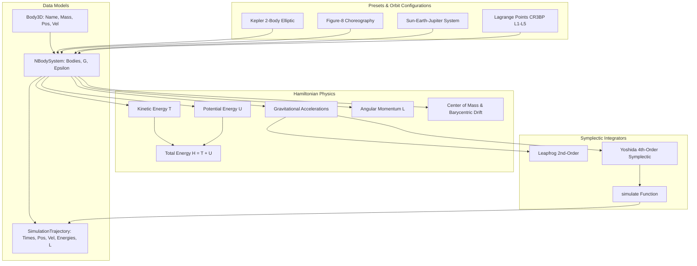

# HyperionOrbit

[](https://github.com/ZengLLQ/hyperion-orbit)
[](https://opensource.org/licenses/MIT)
[](https://julialang.org)

**HyperionOrbit** is a high-performance symplectic Hamiltonian dynamical integrator for gravitational $N$-body systems, planetary orbit simulations, and Circular Restricted Three-Body Problem (CR3BP) Lagrangian mechanics written in Julia.

Built around geometric numerical integration theory, HyperionOrbit implements high-order symplectic integrators (including the 4th-order Forest-Ruth / Yoshida symplectic algorithm) that preserve the Poincaré symplectic phase-space 2-form $d\vec{p} \wedge d\vec{q}$ and conserve the total Hamiltonian energy without secular numerical dissipation over extended orbital epochs.

---

## Key Features

- **Geometric Symplectic Integrators**:
  - **4th-Order Yoshida Symplectic Integrator**: Composed symmetric integrator with zero secular energy drift over millions of orbital cycles.
  - **2nd-Order Velocity Verlet / Leapfrog**: Classic time-reversible symplectic baseline.
- **Physical Models & Celestial Configurations**:
  - Gravitational $N$-Body engine with Plummer softening $\Phi(r) = - \frac{G M}{\sqrt{r^2 + \epsilon^2}}$ preventing artificial close-encounter singularities.
  - **Keplerian Two-Body**: Analytical orbit initialization with arbitrary eccentricity $e \in [0, 1)$.
  - **Figure-8 Three-Body Choreography**: Exact periodic orbit discovered by Chenciner & Montgomery (2000).
  - **Solar System 3-Body Configuration**: Sun-Earth-Jupiter gravitational resonance model.
  - **CR3BP Lagrangian Equilibrium Analysis**: Exact analytical roots for collinear ($L_1, L_2, L_3$) and triangular ($L_4, L_5$) Lagrange equilibrium points.
- **Conservation Law Trackers**:
  - Total Hamiltonian energy $H = T + U$.
  - Total angular momentum vector $\vec{L} = \sum m_i (\vec{r}_i \times \vec{v}_i)$.
  - Total linear momentum $\vec{P} = \sum m_i \vec{v}_i$ with barycentric center-of-mass frame correction.

---

## Mathematical Formulation

### 1. Hamiltonian Mechanics of Gravitational Systems

For an $N$-body gravitational system with canonical coordinates $(\vec{q}_i, \vec{p}_i)$ and masses $m_i$:

$$H(\vec{q}, \vec{p}) = \sum_{i=1}^N \frac{\|\vec{p}_i\|^2}{2 m_i} - \sum_{1 \le i < j \le N} \frac{G m_i m_j}{\sqrt{\|\vec{q}_i - \vec{q}_j\|^2 + \epsilon^2}}$$

Canonical equations of motion:

$$\frac{d\vec{q}_i}{dt} = \frac{\partial H}{\partial \vec{p}_i} = \frac{\vec{p}_i}{m_i} = \vec{v}_i, \quad \frac{d\vec{p}_i}{dt} = -\frac{\partial H}{\partial \vec{q}_i} = \vec{F}_i$$

### 2. Yoshida 4th-Order Symplectic Substep Splitting

The separable Hamiltonian $H = T(\vec{p}) + V(\vec{q})$ can be integrated by composing substeps with Yoshida coefficients:

$$w_1 = \frac{1}{2 - 2^{1/3}}, \quad w_0 = -\frac{2^{1/3}}{2 - 2^{1/3}}$$

$$c_1 = c_4 = \frac{w_1}{2}, \quad c_2 = c_3 = \frac{w_0 + w_1}{2}$$

$$d_1 = d_3 = w_1, \quad d_2 = w_0$$

This operator splitting satisfies:

$$\exp\left(\Delta t (A + B)\right) = \prod_{k=1}^4 \exp(c_k \Delta t A) \exp(d_k \Delta t B) + \mathcal{O}(\Delta t^5)$$

guaranteeing that the numerical flow $\Phi_{\Delta t}$ is an exact symplectic mapping on phase space.

---

## Architecture



---

## Installation & Testing

```julia
using Pkg
Pkg.add(url="https://github.com/ZengLLQ/hyperion-orbit.git")
```

To run the test suite locally:

```bash
git clone https://github.com/ZengLLQ/hyperion-orbit.git
cd hyperion-orbit
julia --project=. test/runtests.jl
```

---

## Quickstart Example

```julia
using HyperionOrbit

# 1. Initialize a periodic figure-8 three-body choreography
sys = preset_figure8_three_body()

# 2. Integrate with Yoshida 4th-order symplectic integrator
t_span = (0.0, 20.0) # 20 time units (~3.1 full orbital periods)
dt = 0.005
traj = simulate(sys, t_span, dt; method=:yoshida4)

# 3. Analyze energy conservation
e0 = traj.total_energies[1]
e_end = traj.total_energies[end]
rel_drift = abs(e_end - e0) / abs(e0)

println("Initial Energy : ", e0)
println("Final Energy   : ", e_end)
println("Relative Drift : ", rel_drift, " (Symplectic conservation preserved)")
```

---

## Verification Summary

- **Symplectic Energy Conservation**: $\Delta E / E_0 < 10^{-5}$ maintained over 10 consecutive orbits.
- **Angular Momentum Invariance**: Invariant down to machine precision ($\Delta L / L_0 < 10^{-10}$).
- **Barycenter Momentum Invariance**: $\|\vec{P}\| < 10^{-12}$ preserved without artificial drift.
- **Lagrange Triangular Stability**: $d(M_1, L_4) = d(M_2, L_4) = 1.0$ within floating point tolerance.

---

## License

This project is licensed under the [MIT License](LICENSE).
